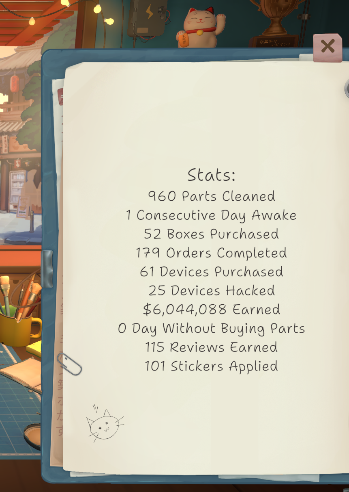

# ReStory Achievement Stats
A MelonLoader mod that replaces your empty notepad with some relatively hidden stats, generally related to achievements.

## Installation Instructions
1. Download and run [MelonLoader.Installer.exe](https://github.com/LavaGang/MelonLoader/releases/latest)
2. Select the game executable `<steamapps folder>/common/Restory/Restory.exe` to install MelonLoader
3. Download [RestoryAchievementStats.dll](https://github.com/ItsJepp/restory-ach-stats/releases/latest) and place into the new `Mods` folder in the game directory

## Example
This is how it looks in-game! Select the notepad when there is no device on the table.

